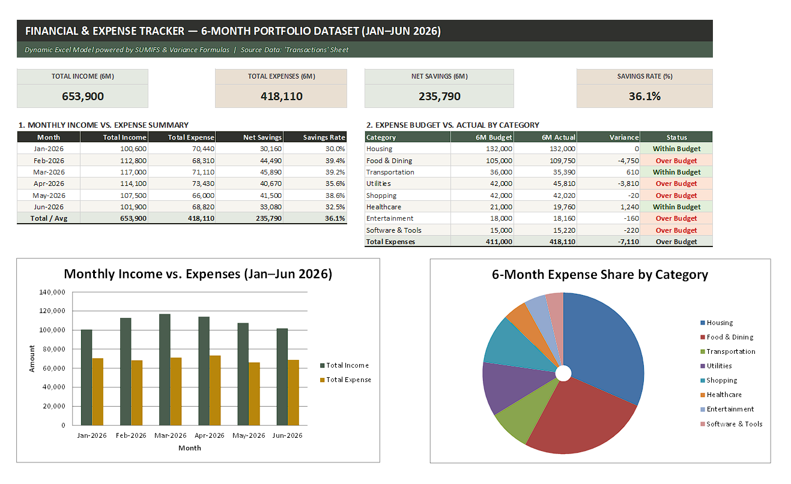

# Financial & Expense Tracker Dashboard (Microsoft Excel)

## Project Overview
An interactive 6-month **Financial & Expense Tracker Dashboard** (Jan 2026 – Jun 2026) designed to monitor personal and freelance cash flow, analyze category-wise spending habits, and track budget variances.

## Key Metrics & Insights (6-Month Summary)
* **Total Income:** 653,900
* **Total Expenses:** 418,110
* **Net Savings:** 235,790 (**36.1% Savings Rate**)
* **Key Finding:** Identified seasonal expense spikes in Shopping (April) and Utilities (May), while keeping core fixed costs within budget.

## Tools & Excel Features Used
* **Dynamic Formulas:** `SUMIFS`, `IF`, and automated variance calculations (`Budget - Actual`).
* **Data Modeling:** Structured 154 transaction records across 8 expense categories and 3 income streams.
* **Data Visualization:** KPI summary cards, Monthly Income vs. Expense clustered column chart, and Category-wise Doughnut breakdown.
* **Conditional Formatting:** Automated status indicators (`Within Budget` vs. `Over Budget`).

## Dashboard Preview

## How to Use
1. Download the `Financial_Expense_Tracker_6M_Dataset-v2.xlsx` file from this repository.
2. Open the **`Summary_Overview`** tab to explore the KPIs and charts.
3. Open the **`Transactions`** tab to view the raw structured dataset or build custom Pivot Tables and Slicers.
